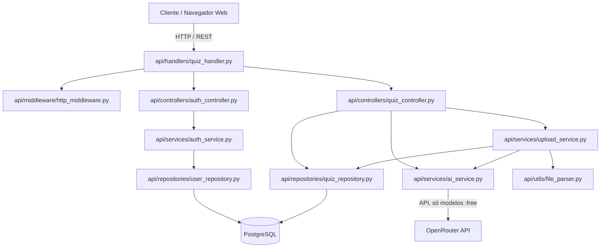

# Acely — Arquitetura

Visão detalhada das camadas, rotas e decisões de segurança. As regras do projeto (liberdades,
proibições e o mapa de busca rápida) ficam em [`AGENTS.md`](../AGENTS.md); este documento só
detalha o que aquele mapa aponta.

---

## 🏗️ Diagrama



---

## 🧭 Fluxo de Dados e Camadas

### 1. Camada de Apresentação (Frontend)
- **`public/web/index.html`**: Página principal da aplicação. Contém o cabeçalho, barra de ferramentas, seletor de questionário customizado, cronômetro, container do quiz e os modais (`uploadModal`, `resultModal`, `catalogModal`, `aboutModal`, `confirmSubmitModal`, `timerModal`).
- **`public/web/styles.css`**: Toda a folha de estilos do projeto. Contém tokens de cores (Claro / Noturno grafite neutro), estilos de componentes, e regras responsivas para mobile/tablet (`@media (max-width: 768px)` e `@media (max-width: 380px)`).
- **`public/web/app.js`**: Orquestrador do frontend. Gerencia renderização de perguntas, seleção de alternativas, envio de respostas para `/api/quiz/submit`, cronômetro, upload de arquivos (`doUpload`), geração por tema (`doGenerateTopic`), e controle de estado do aluno (guest vs logado).
- **`public/web/modules/theme.js`**: Gerenciador de alternância de tema (Claro / Noturno / Sistema) com persistência em `localStorage` e prevenção de FOUC.
- **`public/web/modules/shortcuts.js`**: Mapeamento de teclas de atalho (A-D, 1-4, setas para navegação, Ctrl+Enter para finalizar).
- **`public/web/modules/stats.js`**: Cálculo de métricas pedagógicas, taxa de acerto por disciplina/seção e ritmo de prova (tempo por questão).
- **`public/web/modules/i18n.js`, `public/web/modules/i18n-boot.js`, `public/web/modules/i18n/en.js`**: Tradução da interface (PT/EN). O português do HTML/JS é o texto-fonte; o dicionário traduz textos e atributos e um `MutationObserver` cobre o que o `app.js` gera depois. Escolha salva em `localStorage` (`quiz_lang`).
- **`public/web/termos.html`, `public/web/privacidade.html`, `404.html` (raiz)**: Páginas legais (LGPD) e 404 própria.
- **`public/web/login.html` & `public/web/register.html`**: Telas de login e cadastro. Aceitam `?next=` (só caminhos internos) para devolver a pessoa ao ponto onde estava.
- **`public/web/inicio.html`** (raiz `/`, apelido `/inicio`): página inicial no estilo estúdio escuro (referências basement.studio e lenis.dev), sempre escura, com `inicio.css`, `modules/inicio.js`, `modules/smooth-scroll.js` (rolagem suave própria: roda do mouse com *lerp*, nativa no toque e com `prefers-reduced-motion`) e `modules/mural.js` (cartão-resposta animado em canvas). Os blocos e cartões levam ao app por links diretos: `/app?abrir=criar`, `/app?abrir=arquivo`, `/app?abrir=tema&tema=Assunto`, `/app?abrir=explorar` e `/app?simulado=<nome>` (tratados no fim do `init` do `app.js`; visitante passa pelo modal de acesso antes de criar).
- **Simulados abertos em `/app`** (`index.html`; `/guest` e links antigos na raiz com `?abrir=`, `?simulado=` ou `?email=` também abrem o app): servidos a qualquer visitante. Sem `?next=`, o login leva para `/app`. `public/web/app.js` distingue visitante, convidado e conta (`sessionKind()`), mostra o modal de acesso (`#accessModal`) quando o visitante tenta criar um simulado ou usar a IA, e exibe a cota de IA do convidado (`#guestAiChip`).

### 2. Camada de Roteamento e Handlers (Backend HTTP)
- **`api/handlers/quiz_handler.py`**: O roteador central HTTP (`BaseHTTPRequestHandler`). Trata:
  - `POST /api/auth/email-code` (envia o código de 6 dígitos; 429 com `retry_after` no reenvio cedo demais), `POST /api/auth/email-code/verify` (entra ou cria a conta com o código; cookie HttpOnly como no login)
  - `POST /api/auth/login` (tela só em `/login?senha=1`, usada pelo admin), `POST /api/auth/register` (sem tela: o cadastro é pelo código), `POST /api/auth/logout`, `GET /api/auth/me`
  - `POST /api/auth/forgot-password`, `POST /api/auth/reset-password`, `GET /api/auth/verify-reset-token`
  - `GET /api/auth/providers`, `GET /api/auth/google/start`, `GET /api/auth/google/callback` (login com Google)
  - `GET /api/account/export`, `POST /api/account/delete-code` (código para confirmar a exclusão), `POST /api/account/delete` (LGPD; confirma com `code`, ou `password` em clientes antigos), `POST /api/quizzes/import` (simulados do convidado)
  - `GET /api/user/attempts` (histórico e caderno de erros)
  - `POST /api/guest/start`, `POST /api/guest/end`, `GET /api/guest/status` (sessão de convidado e cota de IA)
  - `GET /api/me/plan` (plano da conta, limites e uso do mês; `api/services/entitlements_service.py`)
  - `GET /api/admin/ia` e `POST /api/admin/ia/teste` (só admin: diagnóstico dos provedores de IA e um pedido mínimo a cada um; nunca devolvem chaves)
  - `GET /api/quizzes`, `GET /api/quiz/{name}`
  - `POST /api/upload` (processamento de arquivos multipart)
  - `POST /api/quiz/generate` (geração de simulado por tema via IA; aceita `language`)
  - `GET /api/quiz/jobs/<request_id>` (andamento de um pedido de IA: `running`, `done` com o resultado ou `failed`; só o dono vê)
  - `POST /api/quiz/submit` (correção e validação de gabarito)
  - `POST /api/quiz/remix-mistakes` (variação de questões erradas via IA; aceita `language`)
  - As três rotas de IA aceitam `request_id` (uuid gerado no navegador). Com ele, o mesmo pedido repetido (página recarregada, conexão caída) devolve o resultado já pronto sem chamar a IA nem gastar cota, ou `202` enquanto ainda roda. O navegador guarda o pedido em `sessionStorage` (`quiz_pending_job`) e retoma ao abrir a página.
- **`api/middleware/http_middleware.py`**: Utilitários para extração de token de sessão dos cookies, parsing de IP do cliente, formatação de respostas JSON padronizadas e recusa de POST vindo de outro site (`Origin` / `Sec-Fetch-Site`).

### 3. Camada de Controle e Negócio (Controllers & Services)
- **`api/controllers/quiz_controller.py`**: Recebe chamadas do handler, orquestra serviços e formata respostas de quizzes e uploads.
- **`api/controllers/auth_controller.py`**: Controla operações de autenticação e validação de payload.
- **`api/services/ai_service.py`**: `_call_ai` percorre os provedores com chave na ordem de `AI_PROVIDERS` (padrão OpenAI → Groq → Gemini → Cerebras → OpenRouter), todos no formato de chat da OpenAI. Na OpenAI (nome interno `codex`, `OPENAI_API_KEY`/`OPENAI_MODELS`, padrão `gpt-6-luna,gpt-4o-mini`): modelos de raciocínio (gpt-5, gpt-6, o-series) vão sem `temperature` e com esforço `low`; modelo com data de desligamento vencida em `OPENAI_MODEL_SHUTDOWNS` é pulado sem pedido; organização sem verificação que não pode receber em partes recebe a resposta inteira (`stream: false`, lembrado por modelo); 429 `insufficient_quota` (sem créditos) pausa o provedor por 15 min sem tentar os outros modelos; 404 `model_not_found` pausa só o modelo por 6 h. Toda falha vai para o log com o motivo do provedor (sem a chave), e na primeira chamada de cada instância o log mostra a ordem dos provedores e os avisos de configuração (chave fora de `AI_PROVIDERS`, nome desconhecido, modelo vencendo). O admin vê o mesmo em Minha conta (`GET /api/admin/ia`) e pode testar cada provedor (`POST /api/admin/ia/teste`). Limite diário (429 "per day") pausa o modelo até a virada do dia (UTC) e, se todos os modelos do provedor estiverem assim, o provedor; chave recusada pausa o provedor por 15 min; em ambos passa ao próximo sem erro para a pessoa. Orçamento diário por modelo (`<PROVEDOR>_DAILY_REQUESTS`/`_TOKENS`, contado em `rate_limits`) pula o modelo antes do 429. No gpt-oss vai `reasoning_effort: low` com folga no limite; o Groq não recebe `response_format` (não aceita com streaming). Sem as chaves novas, só o OpenRouter é usado, como antes. No OpenRouter, só modelos gratuitos (`:free`): os preferidos de `OPENROUTER_FREE_MODELS` e, como reserva, os descobertos na lista pública (cache de 6 h). Se um modelo falha, tenta o próximo e pausa o que falhou. Os modelos gratuitos raciocinam antes de responder e o raciocínio gasta o mesmo `max_tokens`, então o raciocínio vai desligado (effort `none`); se o modelo recusar, repete com effort `low` e 50% de folga no limite. Conta com "ZDR Endpoints Only" ligado bloqueia todos os gratuitos (404 "ZDR violation"): o serviço para na hora e registra no log onde mudar. Teto global diário (`AI_DAILY_CALL_LIMIT`, conta cada chamada ao provedor). Velocidade da geração por tema (meta: até ~10 s em qualquer tamanho): com a OpenAI na frente, o simulado sai em partes de 3 questões geradas todas ao mesmo tempo (até 10; `AI_PART_SIZE`/`AI_PARALLEL_PARTS` mudam isso), com raciocínio `none` ao escrever as questões, explicação de 1 a 2 frases e JSON em uma linha; só com provedores gratuitos, partes de 5 e até 3 ao mesmo tempo (limites por minuto do Groq). Modelo que recusa `none` recebe `low`; `OPENAI_SERVICE_TIER=fast` liga o Fast mode da OpenAI. Para quem tem conta, um segundo modelo (de preferência outro provedor, com raciocínio `low`) confere o gabarito de cada parte assim que ela fica pronta, sem ver a resposta (`AI_CROSS_CHECK`); o total fica perto do tempo de uma parte mais a sua conferência. Cada parte recebe um foco diferente (conceitos, aplicação, casos, comparação...) para as partes não repetirem as mesmas questões, e o prompt manda seguir exatamente a prova, o curso e o ano citados no tema (ENADE não vira ENEM). O título passa por `_clean_quiz_title`: perde o "Parte N" e, se a IA trocou a prova ou esqueceu o ano do tema, vira o próprio tema. Parte que não responde em `AI_HEDGE_AFTER_SECONDS` (padrão 9) ganha um segundo pedido igual, de preferência a outro provedor, e vale o primeiro que chegar (`_call_ai_hedged`). Se, depois de juntar as partes e tirar as repetidas, faltar questão (parte que falhou, repetidas, reprovadas na validação ou na conferência), um pedido extra pede só as que faltam, mostrando as que já existem para não repetir (até 40 s do início). O resultado traz `requested` e `generation` (pedidas, entregues, partes, falhas, repetidas, reprovadas por motivo, pedido em dobro, pedido extra, tempos e modelos); o controller repassa `requested_count` e `generation`, e a mensagem diz "X de Y questões pedidas" quando veio menos. Só o simulado completo entra no cache. Cada simulado gera uma linha de log com esses números, e o diagnóstico do admin mostra a média, o p90 e a fatia em até 10 s das últimas 24 h e as últimas gerações, uma por linha, com o que deu errado (lidos de `ai_jobs`, sem cache nem temas prontos). `scripts/benchmark_geracao_ia.py` mede o fluxo contra uma OpenAI simulada, sem gastar tokens. A geração mantém o progresso no job e remove enunciados repetidos; `validate_question` reprova gabarito fora do intervalo, alternativas repetidas e idioma trocado. Os 4 temas de exemplo da tela (`api/utils/sample_quizzes.py`) respondem prontos, sem IA, sem cota e mesmo sem chave configurada. A resposta vem em partes (streaming): um modelo que fica `AI_ATTEMPT_TIMEOUT` s (padrão 20) sem mandar nada é abandonado e o próximo é tentado, sem cortar um modelo que já está escrevendo; cada tentativa gera uma linha de log com o tempo. Simulados por tema ficam em cache em dois níveis: memória (1 h) e tabela `ai_cache` (`AI_CACHE_TTL_DAYS`, padrão 7); o que vem do cache não gasta a cota do convidado. Funções principais:
  - `generate_quiz_by_topic(topic, num_questions, difficulty, context, client_ip, language)`: Cria simulado completo a partir de tema.
  - `parse_and_structure_questions_with_ai(text, max_chars, client_ip, num_questions, context, language)`: Estrutura arquivos sem padrão ou transforma material teórico em questões.
  - `generate_answer_key(questions, client_ip)`: Resolve e cria gabarito fundamentado para questões sem resposta.
  - `remix_questions_by_ai(questions, client_ip, language)`: Gera novas questões mutadas com base nos erros do aluno.
  - `normalize_language(value)`: Converte o idioma pedido pelo cliente (`pt-BR` ou `en`; padrão `pt-BR`).
- **`api/services/upload_service.py`**: Validação de peso, extração de texto (via `file_parser.py`), detecção de gabarito, corte pela quantidade escolhida (`num_questions`) e persistência.
- **`api/services/guest_service.py`**: Modo convidado. Gera o id do cookie `qs_guest` e controla a cota gratuita de IA (`GUEST_AI_LIMIT` usos por `GUEST_AI_WINDOW_HOURS`, com teto por IP `GUEST_AI_IP_LIMIT`). A reserva é atômica e é devolvida se a geração falhar.
- **`api/services/google_auth_service.py`**: Login com Google (OAuth com `state` em cookie); fica desligado sem `GOOGLE_CLIENT_ID`/`GOOGLE_CLIENT_SECRET`.
- **`api/services/import_service.py`**: Salva na conta os simulados criados como convidado, ao entrar ou se cadastrar.
- **`api/services/email_service.py`**: Envio do e-mail de redefinição de senha.
- **`api/services/auth_service.py`**: Criação de hash seguro de senhas com PBKDF2 (600k iterações), geração e validação de tokens de sessão opacos (armazenados como hash SHA-256 no banco).
  - **Entrar com código por e-mail** (`request_email_code`, `login_with_email_code`): 6 dígitos de `secrets`, guardados na tabela `email_codes` só como HMAC-SHA256 (chave `AUTH_CODE_SECRET`, ligada ao e-mail e à finalidade `login`/`delete_account`). Vale `LOGIN_CODE_TTL_MINUTES` (10), aceita `LOGIN_CODE_MAX_ATTEMPTS` (5) palpites, reenvio após `LOGIN_CODE_RESEND_SECONDS` (60) e no máximo `LOGIN_CODE_MAX_PER_HOUR` (5) por e-mail. O código certo cria a conta (e-mail confirmado) se ela não existir; conta antiga sem e-mail confirmado tem a senha trocada por uma aleatória e as sessões derrubadas, como no Google. O admin não recebe código (resposta igual à de qualquer e-mail) e entra só com usuário e senha.

### 4. Camada de Dados e Persistência (Repositories & Database)
- **`api/database/migrations.py`**: Migrações idempotentes do schema PostgreSQL (usuários, simulados, sessões, limites, pedidos e cache de IA, planos, códigos por e-mail).
- **`api/repositories/quiz_repository.py`**: Operações SQL para salvar, buscar e listar quizzes públicos e privados.
- **`api/repositories/user_repository.py`**: Operações SQL de usuários e sessões ativas, exportação (`export_user_data`) e exclusão de conta (`delete_user_and_data`).
- **`api/repositories/rate_limit_repository.py`**: Contadores persistentes de rate limit e cotas de IA.
- **`api/repositories/ai_job_repository.py`**: Pedidos de IA por `request_id` (tabela `ai_jobs`, guardados 24 h; `running` parado há mais de 6 min vira `failed`) e cache de simulados por tema (tabela `ai_cache`). Com o banco fora, usa a memória do processo.

### 5. Configuração e Ponto de Entrada
- **`quiz_api.py`**: Ponto de entrada local (Docker, Procfile) que inicializa migrações e sobe o `ThreadingHTTPServer`.
- **`api/index.py`**: Ponto de entrada da Vercel; recebe todas as rotas `/api/*` pelo `rewrite` de `vercel.json`.
- **`api/utils/config.py`**: Leitura de variáveis de ambiente (`PORT`, `HOST`, `DATABASE_URL`, `OPENROUTER_API_KEY`, `OPENROUTER_FREE_MODELS`, `AI_DAILY_CALL_LIMIT`, `GUEST_AI_LIMIT`, `GOOGLE_CLIENT_ID`, `APP_URL`, etc.).

### 6. Scripts de manutenção (`scripts/`)
- **`reset_admin.py`**, **`reset_sessions.py`**, **`reset_database.py`**: Operações administrativas no banco (a última também roda pelo workflow `reset-database.yml`).
- **`load_test_real_api.py`**: Teste de carga contra a API real (gasta cota de IA; não roda no `unittest discover`).

---

## 🧪 Como executar e validar

```bash
python quiz_api.py                                  # servidor local
python -m unittest discover tests                   # suíte completa
python -m unittest tests/test_security_fixes.py     # um arquivo
```

---

## 🛡️ Modelo de segurança de dados e decisão sobre RLS

### Row-Level Security (RLS) vs. isolamento na aplicação
- **Decisão:** isolamento por dono na camada de repositório, com queries parametrizadas (`WHERE is_public = TRUE OR created_by = %s` e `WHERE user_id = %s`).
- **Motivo:** o backend conecta ao PostgreSQL por pool em ambiente serverless (Neon/PgBouncer) com uma única role de serviço. RLS com `FORCE ROW LEVEL SECURITY` dependeria de `SET LOCAL app.user_id` a cada requisição, com roundtrips extras e risco de estado reaproveitado no pool transacional.
- **Garantia:** toda leitura e correção passa pelos repositórios que aplicam o filtro de dono. Só administradores alteram `is_public`.
- **Supabase:** a API REST automática dele não é usada. `scripts/sql/supabase_fechar_api_publica.sql` liga RLS **sem** `FORCE` (o dono das tabelas, usado pelo app, não é afetado) e revoga `anon`/`authenticated`, só para fechar essa API. Ver `docs/BANCO_DE_DADOS.md`.
- **Schema:** `is_public` tem `DEFAULT FALSE` no `CREATE TABLE` e no `ALTER TABLE`, para que quizzes antigos não fiquem públicos sem querer.

### Mitigações de auditoria
1. **Timing attack no login:** usuário inexistente roda PBKDF2-HMAC-SHA256 (600.000 iterações) contra salt e hash sentinelas (`_DUMMY_SALT`, `_DUMMY_HASH`), igualando o tempo de resposta e impedindo enumeração de contas.
2. **Rate limit por falhas com chave composta:** `/api/auth/login` conta só falhas consecutivas por `(IP + usuário)`. Um atacante só bloqueia o próprio IP para aquele usuário, e logins bem-sucedidos limpam o contador (redes com NAT não sofrem).
3. **Criptografia em trânsito:** bancos remotos usam `sslmode=verify-full` por padrão (ajustável via `DB_SSLMODE`), com o arquivo de autoridades do `certifi` ou o certificado de `DB_SSLROOTCERT`/`DB_SSLROOTCERT_PEM`. URL com `sslmode` mais fraco gera um aviso no log. Detalhes em `docs/BANCO_DE_DADOS.md`.
