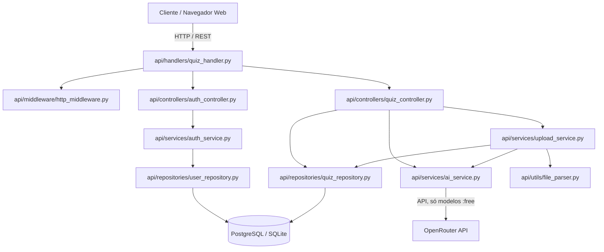

# Acely — Arquitetura

Visão detalhada das camadas, rotas e decisões de segurança. As regras do projeto (liberdades,
proibições e o mapa de busca rápida) ficam em [`AGENTS.md`](../AGENTS.md); este documento só
detalha o que aquele mapa aponta.

---

## 🏗️ Diagrama



---

## 🧭 Fluxo de Dados e Camadas

### 1. Camada de Apresentação (Frontend)
- **`public/web/index.html`**: Página principal da aplicação. Contém o cabeçalho, barra de ferramentas, seletor de questionário customizado, cronômetro, container do quiz e os modais (`uploadModal`, `resultModal`, `catalogModal`, `aboutModal`, `confirmSubmitModal`, `timerModal`).
- **`public/web/styles.css`**: Toda a folha de estilos do projeto. Contém tokens de cores (Claro / Noturno grafite neutro), estilos de componentes, e regras responsivas para mobile/tablet (`@media (max-width: 768px)` e `@media (max-width: 380px)`).
- **`public/web/app.js`**: Orquestrador do frontend. Gerencia renderização de perguntas, seleção de alternativas, envio de respostas para `/api/quiz/submit`, cronômetro, upload de arquivos (`doUpload`), geração por tema (`doGenerateTopic`), e controle de estado do aluno (guest vs logado).
- **`public/web/modules/theme.js`**: Gerenciador de alternância de tema (Claro / Noturno / Sistema) com persistência em `localStorage` e prevenção de FOUC.
- **`public/web/modules/shortcuts.js`**: Mapeamento de teclas de atalho (A-D, 1-4, setas para navegação, Ctrl+Enter para finalizar).
- **`public/web/modules/stats.js`**: Cálculo de métricas pedagógicas, taxa de acerto por disciplina/seção e ritmo de prova (tempo por questão).
- **`public/web/modules/i18n.js`, `public/web/modules/i18n-boot.js`, `public/web/modules/i18n/en.js`**: Tradução da interface (PT/EN). O português do HTML/JS é o texto-fonte; o dicionário traduz textos e atributos e um `MutationObserver` cobre o que o `app.js` gera depois. Escolha salva em `localStorage` (`quiz_lang`).
- **`public/web/termos.html`, `public/web/privacidade.html`, `404.html` (raiz)**: Páginas legais (LGPD) e 404 própria.
- **`public/web/login.html` & `public/web/register.html`**: Telas de login e cadastro. Aceitam `?next=` (só caminhos internos) para devolver a pessoa ao ponto onde estava.
- **Home aberta**: `/` é servida a qualquer visitante. `public/web/app.js` distingue visitante, convidado e conta (`sessionKind()`), mostra o modal de acesso (`#accessModal`) quando o visitante tenta criar um simulado ou usar a IA, e exibe a cota de IA do convidado (`#guestAiChip`).

### 2. Camada de Roteamento e Handlers (Backend HTTP)
- **`api/handlers/quiz_handler.py`**: O roteador central HTTP (`BaseHTTPRequestHandler`). Trata:
  - `POST /api/auth/login`, `POST /api/auth/register`, `POST /api/auth/logout`, `GET /api/auth/me`
  - `POST /api/auth/forgot-password`, `POST /api/auth/reset-password`, `GET /api/auth/verify-reset-token`
  - `GET /api/auth/providers`, `GET /api/auth/google/start`, `GET /api/auth/google/callback` (login com Google)
  - `GET /api/account/export`, `POST /api/account/delete` (LGPD), `POST /api/quizzes/import` (simulados do convidado)
  - `GET /api/user/attempts` (histórico e caderno de erros)
  - `POST /api/guest/start`, `POST /api/guest/end`, `GET /api/guest/status` (sessão de convidado e cota de IA)
  - `GET /api/quizzes`, `GET /api/quiz/{name}`
  - `POST /api/upload` (processamento de arquivos multipart)
  - `POST /api/quiz/generate` (geração de simulado por tema via IA; aceita `language`)
  - `GET /api/quiz/jobs/<request_id>` (andamento de um pedido de IA: `running`, `done` com o resultado ou `failed`; só o dono vê)
  - `POST /api/quiz/submit` (correção e validação de gabarito)
  - `POST /api/quiz/remix-mistakes` (variação de questões erradas via IA; aceita `language`)
  - As três rotas de IA aceitam `request_id` (uuid gerado no navegador). Com ele, o mesmo pedido repetido (página recarregada, conexão caída) devolve o resultado já pronto sem chamar a IA nem gastar cota, ou `202` enquanto ainda roda. O navegador guarda o pedido em `sessionStorage` (`quiz_pending_job`) e retoma ao abrir a página.
- **`api/middleware/http_middleware.py`**: Utilitários para extração de token de sessão dos cookies, parsing de IP do cliente, formatação de respostas JSON padronizadas e recusa de POST vindo de outro site (`Origin` / `Sec-Fetch-Site`).

### 3. Camada de Controle e Negócio (Controllers & Services)
- **`api/controllers/quiz_controller.py`**: Recebe chamadas do handler, orquestra serviços e formata respostas de quizzes e uploads.
- **`api/controllers/auth_controller.py`**: Controla operações de autenticação e validação de payload.
- **`api/services/ai_service.py`**: `_call_ai` percorre os provedores com chave na ordem de `AI_PROVIDERS` (padrão Groq → Gemini → Cerebras → OpenRouter), todos no formato de chat da OpenAI. Limite diário (429 "per day") pausa o modelo até a virada do dia (UTC) e, se todos os modelos do provedor estiverem assim, o provedor; chave recusada pausa o provedor por 15 min; em ambos passa ao próximo sem erro para a pessoa. Orçamento diário por modelo (`<PROVEDOR>_DAILY_REQUESTS`/`_TOKENS`, contado em `rate_limits`) pula o modelo antes do 429. No gpt-oss vai `reasoning_effort: low` com folga no limite; o Groq não recebe `response_format` (não aceita com streaming). Sem as chaves novas, só o OpenRouter é usado, como antes. No OpenRouter, só modelos gratuitos (`:free`): os preferidos de `OPENROUTER_FREE_MODELS` e, como reserva, os descobertos na lista pública (cache de 6 h). Se um modelo falha, tenta o próximo e pausa o que falhou. Os modelos gratuitos raciocinam antes de responder e o raciocínio gasta o mesmo `max_tokens`, então o raciocínio vai desligado (effort `none`); se o modelo recusar, repete com effort `low` e 50% de folga no limite. Conta com "ZDR Endpoints Only" ligado bloqueia todos os gratuitos (404 "ZDR violation"): o serviço para na hora e registra no log onde mudar. Teto global diário (`AI_DAILY_CALL_LIMIT`). A resposta vem em partes (streaming): um modelo que fica `AI_ATTEMPT_TIMEOUT` s (padrão 20) sem mandar nada é abandonado e o próximo é tentado, sem cortar um modelo que já está escrevendo; cada tentativa gera uma linha de log com o tempo. Simulados por tema ficam em cache em dois níveis: memória (1 h) e tabela `ai_cache` (`AI_CACHE_TTL_DAYS`, padrão 7); o que vem do cache não gasta a cota do convidado. Funções principais:
  - `generate_quiz_by_topic(topic, num_questions, difficulty, context, client_ip, language)`: Cria simulado completo a partir de tema.
  - `parse_and_structure_questions_with_ai(text, max_chars, client_ip, num_questions, context, language)`: Estrutura arquivos sem padrão ou transforma material teórico em questões.
  - `generate_answer_key(questions, client_ip)`: Resolve e cria gabarito fundamentado para questões sem resposta.
  - `remix_questions_by_ai(questions, client_ip, language)`: Gera novas questões mutadas com base nos erros do aluno.
  - `normalize_language(value)`: Converte o idioma pedido pelo cliente (`pt-BR` ou `en`; padrão `pt-BR`).
- **`api/services/upload_service.py`**: Validação de peso, extração de texto (via `file_parser.py`), detecção de gabarito, corte pela quantidade escolhida (`num_questions`) e persistência.
- **`api/services/guest_service.py`**: Modo convidado. Gera o id do cookie `qs_guest` e controla a cota gratuita de IA (`GUEST_AI_LIMIT` usos por `GUEST_AI_WINDOW_HOURS`, com teto por IP `GUEST_AI_IP_LIMIT`). A reserva é atômica e é devolvida se a geração falhar.
- **`api/services/google_auth_service.py`**: Login com Google (OAuth com `state` em cookie); fica desligado sem `GOOGLE_CLIENT_ID`/`GOOGLE_CLIENT_SECRET`.
- **`api/services/import_service.py`**: Salva na conta os simulados criados como convidado, ao entrar ou se cadastrar.
- **`api/services/email_service.py`**: Envio do e-mail de redefinição de senha.
- **`api/services/auth_service.py`**: Criação de hash seguro de senhas com PBKDF2 (600k iterações), geração e validação de tokens de sessão opacos (armazenados como hash SHA-256 no banco).

### 4. Camada de Dados e Persistência (Repositories & Database)
- **`api/database/migrations.py`**: Migrações do schema PostgreSQL (tabelas `users`, `quizzes`, `sessions`) com fallback em memória SQLite.
- **`api/repositories/quiz_repository.py`**: Operações SQL para salvar, buscar e listar quizzes públicos e privados.
- **`api/repositories/user_repository.py`**: Operações SQL de usuários e sessões ativas, exportação (`export_user_data`) e exclusão de conta (`delete_user_and_data`).
- **`api/repositories/rate_limit_repository.py`**: Contadores persistentes de rate limit e cotas de IA.
- **`api/repositories/ai_job_repository.py`**: Pedidos de IA por `request_id` (tabela `ai_jobs`, guardados 24 h; `running` parado há mais de 6 min vira `failed`) e cache de simulados por tema (tabela `ai_cache`). Com o banco fora, usa a memória do processo.

### 5. Configuração e Ponto de Entrada
- **`quiz_api.py`**: Ponto de entrada local (Docker, Procfile) que inicializa migrações e sobe o `ThreadingHTTPServer`.
- **`api/index.py`**: Ponto de entrada da Vercel; recebe todas as rotas `/api/*` pelo `rewrite` de `vercel.json`.
- **`api/utils/config.py`**: Leitura de variáveis de ambiente (`PORT`, `HOST`, `DATABASE_URL`, `OPENROUTER_API_KEY`, `OPENROUTER_FREE_MODELS`, `AI_DAILY_CALL_LIMIT`, `GUEST_AI_LIMIT`, `GOOGLE_CLIENT_ID`, `APP_URL`, etc.).

### 6. Scripts de manutenção (`scripts/`)
- **`reset_admin.py`**, **`reset_sessions.py`**, **`reset_database.py`**: Operações administrativas no banco (a última também roda pelo workflow `reset-database.yml`).
- **`load_test_real_api.py`**: Teste de carga contra a API real (gasta cota de IA; não roda no `unittest discover`).

---

## 🧪 Como executar e validar

```bash
python quiz_api.py                                  # servidor local
python -m unittest discover tests                   # suíte completa
python -m unittest tests/test_security_fixes.py     # um arquivo
```

---

## 🛡️ Modelo de segurança de dados e decisão sobre RLS

### Row-Level Security (RLS) vs. isolamento na aplicação
- **Decisão:** isolamento por dono na camada de repositório, com queries parametrizadas (`WHERE is_public = TRUE OR created_by = %s` e `WHERE user_id = %s`).
- **Motivo:** o backend conecta ao PostgreSQL por pool em ambiente serverless (Neon/PgBouncer) com uma única role de serviço. RLS com `FORCE ROW LEVEL SECURITY` dependeria de `SET LOCAL app.user_id` a cada requisição, com roundtrips extras e risco de estado reaproveitado no pool transacional.
- **Garantia:** toda leitura e correção passa pelos repositórios que aplicam o filtro de dono. Só administradores alteram `is_public`.
- **Supabase:** a API REST automática dele não é usada. `scripts/sql/supabase_fechar_api_publica.sql` liga RLS **sem** `FORCE` (o dono das tabelas, usado pelo app, não é afetado) e revoga `anon`/`authenticated`, só para fechar essa API. Ver `docs/BANCO_DE_DADOS.md`.
- **Schema:** `is_public` tem `DEFAULT FALSE` no `CREATE TABLE` e no `ALTER TABLE`, para que quizzes antigos não fiquem públicos sem querer.

### Mitigações de auditoria
1. **Timing attack no login:** usuário inexistente roda PBKDF2-HMAC-SHA256 (600.000 iterações) contra salt e hash sentinelas (`_DUMMY_SALT`, `_DUMMY_HASH`), igualando o tempo de resposta e impedindo enumeração de contas.
2. **Rate limit por falhas com chave composta:** `/api/auth/login` conta só falhas consecutivas por `(IP + usuário)`. Um atacante só bloqueia o próprio IP para aquele usuário, e logins bem-sucedidos limpam o contador (redes com NAT não sofrem).
3. **Criptografia em trânsito:** bancos remotos usam `sslmode=verify-full` por padrão (ajustável via `DB_SSLMODE`), com o arquivo de autoridades do `certifi` ou o certificado de `DB_SSLROOTCERT`/`DB_SSLROOTCERT_PEM`. URL com `sslmode` mais fraco gera um aviso no log. Detalhes em `docs/BANCO_DE_DADOS.md`.
